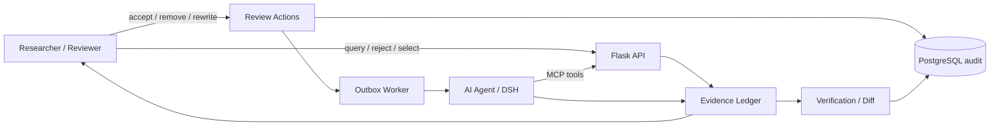

# SciPal Architecture

> **Last updated:** 2026-11-18 · PG-only audit ledger, human-in-the-loop, outbox worker  
> **Canonical machine-readable spec:** [ARCHITECTURE.json](ARCHITECTURE.json)  
> **Canonical overview:** [README.md](README.md) · [ARCHITECTURE.json](ARCHITECTURE.json)

This is the short architecture entry point. Detailed migration history lives in
`docs/`; this file describes the current runtime.

---

## Design principle: human is a runtime node

SciPal 不是“机器给答案，人被动接受”。人是审计回路中的必要节点：

```text
人提出质疑
  -> 系统缩小候选
  -> 人选择/打回/补证据
  -> 机器重写
  -> 人复核
  -> 系统验证并关闭
```



三条底线：

```text
可定位到具体证据
可修复且改完生效
可出示证据链
```

人机分工：

| 角色 | 负责 | 不负责 |
|---|---|---|
| Researcher | 提问题、判断证据、选择范围、接受/关闭 | 让系统替自己做价值判断 |
| Reviewer / Auditor | 复核 claim/evidence、处理 unresolved | 伪造证据链 |
| AI Agent | 检索、组织、重写、结构验证 | 决定科学结论是否成立 |
| System | 账本、版本、哈希链、outbox、diff、复现 | 隐藏错误或跳过审计 |

边界：

```text
格式润色 == 不进账本
事实核查 / claim 修改 == 进账本
```

依据：

- [Code Review](docs/architecture/Code-Review-2026-11-18.md)
- [Preprint Readiness](docs/architecture/Preprint-Readiness.md)
- [Audit Review Plan](docs/architecture/Audit-Review-Plan.md)
- [Routing and Data Flow](docs/architecture/Routing-and-Data-Flow.md)

---

## Current stack

```text
Python 3.12
Flask 3
PostgreSQL 16 + pgvector
ParadeDB BM25 (code_units_bm25)
Zoekt (regex/symbol shards, code-api only)
Vanilla HTML/CSS/JS + PDF.js
Docker Compose: app + code-api + zoekt + paradedb + pg-backup + watch-cron + Caddy + PostgreSQL
Caddy: HTTPS, security headers
Audit: PostgreSQL audit_ledger / audit_event / audit_error / audit_outbox
```

Retired:

```text
SQLite research.db   archived, not mounted, not created
Chroma               archived, not initialized
```

---

## Runtime shape

```text
Browser / DSH / MCP
    -> Caddy (TLS, security headers)
    -> Flask API
       -> scipal_core
       -> scipal_rebuild
       -> scipal_docs
       -> code-api (internal token + workspace)
          -> scipal_code
          -> ParadeDB BM25 (scipal_g0)
          -> Zoekt
       -> services/search, review, claims, projects, watch, ...
       -> build_db/* parsing and corpus writes
    -> documents/ + packs/
```

Route count:

```text
26 blueprints / 316 route+method
```

---

## Data stores and boundaries

```text
scipal_core
  users / auth / workspaces / memberships
  projects / experiments / notes / tasks
  claims / reviews / audit

scipal_rebuild
  papers / sections / paragraphs / sentences
  paragraph_embeddings / citations / figures / tables

scipal_code
  code_sources / snapshots / files / units / edges / symbols
  code_environments / search_events / search_feedback

scipal_g0 (ParadeDB)
  code_units_bm25 (derived lexical index)

scipal_docs
  document libraries
```

Rules:

```text
no cross-database foreign keys
logical IDs only (paper_id / user_id / library_id)
core connections never query corpus tables
corpus connections never query business tables
code-api never writes core/corpus
BM25/Zoekt are derived indexes, never source of truth
```

Known exception:

```text
code-api reads scipal_core.libraries (SELECT only)
for workspace authorization
```

## Security model

```text
global API auth         session / bearer / internal token
internal endpoints      /api/ingest, /api/embed require X-SCIPAL-Internal-Token
database roles          core_app / corpus_reader / corpus_writer
                        no DDL for the application role
code-api                 internal token + workspace header
                         read-only code/core DSNs; no host port
environment guard       production rejects loopback and wrong-database DSNs
secrets                 environment only; never commit real credentials
```

DDL is a migration/owner responsibility:

```text
app startup must not CREATE/ALTER tables
missing plugin schema returns 503
migration scripts:
  scripts/migrate_ingest_tracking.py
  code_rag/schema.sql (code DB + environments/feedback)
```

---

## Backup and recovery

```text
core      every 6h, retain 7d
corpus    every 7d, retain 28d
format    pg_dump custom + AES-256-CBC/PBKDF2
verify    pg_restore --list before encryption
restore   data + GIN + HNSW validated 2026-11-12
```

Do not claim a backup is valid until a restore drill has passed.

---

## Non-negotiable rules

1. Retrieval is deterministic and traceable to paper / section / paragraph / sentence / page / bbox.
2. Claims bind to explicit quotes.
3. State changes are append-only audit events.
4. PostgreSQL is the only production store; do not reintroduce SQLite or Chroma into runtime paths.
5. External capabilities are plugins and must be removable without changing the core.
6. High-risk changes pass the governance gate and human approval.
7. Code answers must cite unit/path/commit; no evidence, no answer.
8. Do not merge scores across literature/code/docs RAG.

---

## Where to look

| Question | Document |
|---|---|
| Runtime overview | [README.md](README.md) |
| Machine contract | [ARCHITECTURE.json](ARCHITECTURE.json) |
| Module responsibilities | [docs/en/Modules-and-Routes.md](docs/en/Modules-and-Routes.md) |
| Data ownership | [docs/数据层隔离审计.md](docs/数据层隔离审计.md) |
| Backup/restore | [docs/备份策略-双库.md](docs/备份策略-双库.md) |
| Restore drill | [docs/恢复演练-20261112.md](docs/恢复演练-20261112.md) |
| Code review findings | [docs/代码审查-20261112.md](docs/代码审查-20261112.md) |
| Governance gate | [docs/工程治理门禁规范.md](docs/工程治理门禁规范.md) |
| Machine-readable architecture | [ARCHITECTURE.json](ARCHITECTURE.json) |
| CodeRAG final report | [docs/architecture/CodeRAG-final-report.md](docs/architecture/CodeRAG-final-report.md) |
| CodeRAG P0 plan | [docs/architecture/CodeRAG-P0-execution-plan.md](docs/architecture/CodeRAG-P0-execution-plan.md) |
| CodeRAG roadmap | [docs/architecture/CodeRAG-capability-roadmap.md](docs/architecture/CodeRAG-capability-roadmap.md) |
| CodeRAG isolation | [docs/architecture/CodeRAG-isolation-audit.md](docs/architecture/CodeRAG-isolation-audit.md) |
