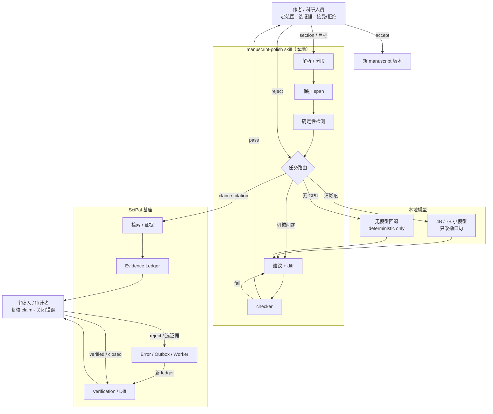
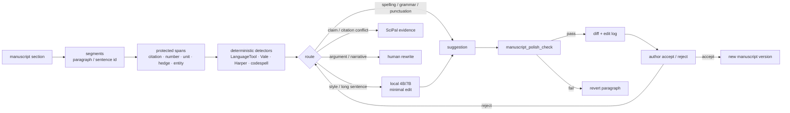
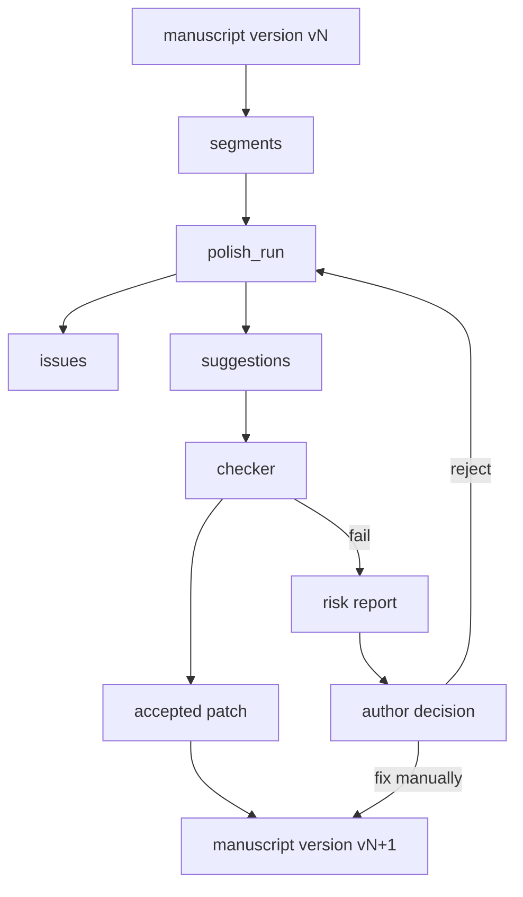
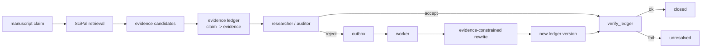
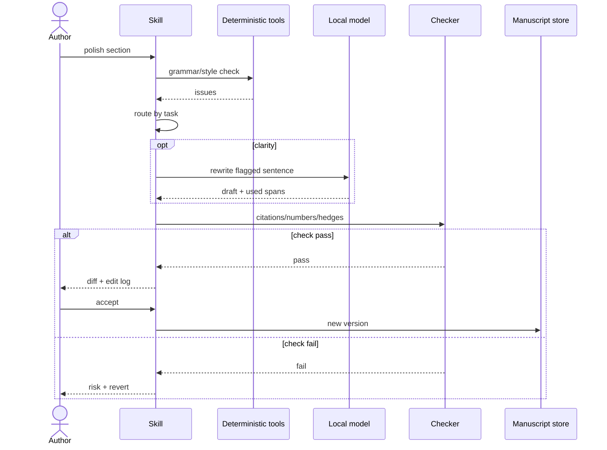
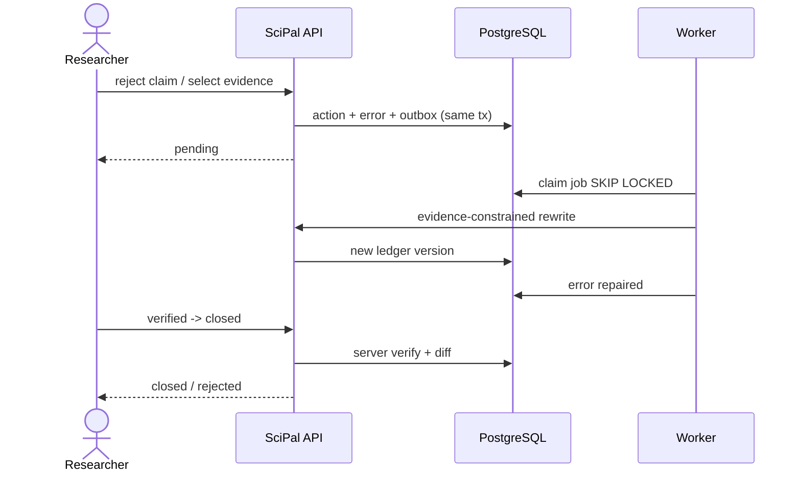

# 路由与数据流（含人的位置）

> 日期：2026-11-18  
> 范围：manuscript-polish skill + SciPal 审计基座  
> 原则：任务拆解、单任务单 owner、人负责判断、系统负责证据链

---

## 1. 总体路由



人不是外部观察者：

```text
作者：定范围、接受/拒绝语言建议
审计者：判断 claim/evidence、决定错误是否关闭
```

---

## 2. 润色 skill 的路由



单任务单 owner：

| 任务 | owner | 是否 GPU | 人是否必须 |
|---|---|---|---|
| 拼写/语法/标点 | LanguageTool | 否 | 接受建议 |
| 学术 style | Vale | 否 | 接受建议 |
| 英文 grammar | Harper | 否 | 接受建议 |
| citation/number 保护 | checker | 否 | 失败即拒绝 |
| 拗口句 | 4B/7B | 是 | 接受建议 |
| 论证 | 人 | 否 | 是 |
| claim/citation 核查 | SciPal | 否 | 是 |

---

## 3. 润色数据流



数据边界：

```text
manuscript store
  manuscript / section / paragraph / version

polish_run
  issues / suggestions / diff / checker result

evidence ledger
  claim / evidence / action / error / outbox
```

规则：

```text
润色数据不进 evidence ledger
证据数据不塞进 manuscript store
```

---

## 4. 证据审计数据流



人的作用：

```text
选择证据范围
判断 claim 是否成立
接受/拒绝新版本
决定 unresolved 还是继续
```

系统的作用：

```text
找回候选
记录 provenance
生成新版本
服务端验证
保存 diff / 哈希链
```

---

## 5. 人机时序：润色



---

## 6. 人机时序：证据审计



---

## 7. 人的位置

| 阶段 | 人做什么 | 系统做什么 |
|---|---|---|
| 开始 | 选 section、目标期刊、范围 | 解析、保护 span |
| 润色 | 接受/拒绝建议 | 检测、路由、checker |
| 证据 | 判断 claim 是否成立 | 检索、账本、provenance |
| 修复 | 选证据、打回、补文献 | outbox、重写、新版本 |
| 关闭 | 确认 verified | 服务端验证、diff、哈希链 |
| 发布 | 承担最终责任 | 保存可复现 artifact |

不可让渡：

```text
科学判断
价值判断
最终署名责任
```

---

## 8. 降级与失败

```text
无 GPU
  -> deterministic only
  -> 不偷偷切云端

checker fail
  -> 拒绝该段
  -> 不自动写回

citation 不存在
  -> 转 evidence 流程
  -> 不在润色里“顺手改”

模型越界
  -> 拒绝 draft
  -> 记录 unresolved
```

---

## 9. 一句话

```text
润色是作者平面
证据审计是证据平面
人在两个平面都负责判断
系统只负责让判断可追溯、可验证、可复现
```
